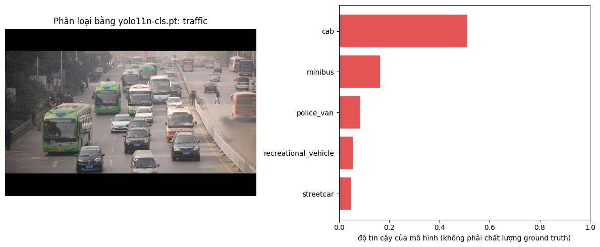
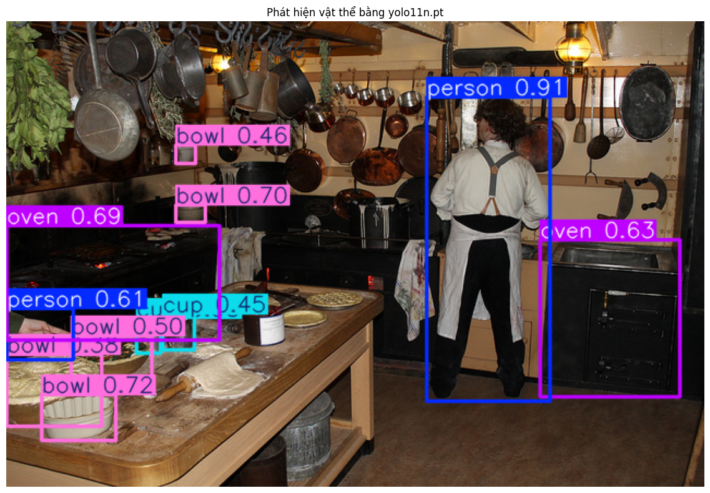
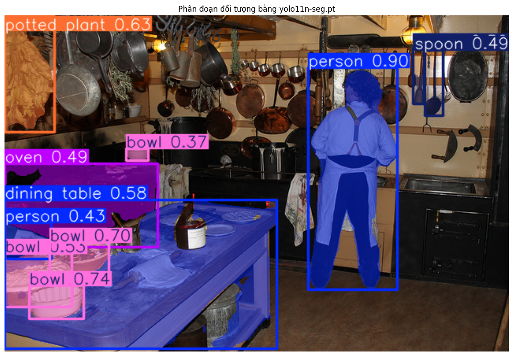

# Báo cáo bài thực hành Ngày 1 – Đọc prediction YOLO11 để hiểu định dạng nhãn

**Ngày chạy:** 06/11/2026

**Runtime Colab:** GPU NVIDIA T4, CUDA

**Python / PyTorch / Ultralytics:** 3.13.16 / 2.11.0+cu130 / 8.4.145

**Checkpoint:** `yolo11n-cls.pt`, `yolo11n.pt`, `yolo11n-seg.pt`

**Ngưỡng detection/segmentation dùng khi tạo JSON:** `0.35`. Ô so sánh detection chạy các ngưỡng có sẵn `0.20`, `0.35`, `0.60` trên ảnh `kitchen`.

**Thay đổi so với notebook nguồn:** Không thay mã nguồn, phiên bản package, checkpoint hoặc threshold. Chạy bản sao notebook nguồn `v1.0.3` trên Google Colab. Ô upload báo cáo từng được chủ động dừng khi chưa có báo cáo; thao tác này không thay đổi các prediction đã tạo.

**Dữ liệu và khả năng tái lập:** Chỉ dùng ba ảnh COCO cố định `traffic` (210273), `kitchen` (397133), `dining` (166918). Các ô kiểm tra SHA-256 của ba ảnh và ba checkpoint đều báo PASS. Checksum đầy đủ của model nằm trong từng JSON; nguồn ảnh và giấy phép nằm trong `day1_lab_outputs/IMAGE_ATTRIBUTION.md`.

| Sample | SHA-256 ảnh nguồn |
| --- | --- |
| traffic | `3ec23de63592c1eef86740fd46fed2cb66170fca02b695d37e6ae379dcee4355` |
| kitchen | `09e1d25c75f7879bdaa69c327fece5cabacd53939c8c2ef9e87f1c97a2e478c4` |
| dining | `a7f8457580a2bb8635ca7acd1b2061ea7977a84418e5e8441a77ba1f861d7e22` |

## 1. Phân loại ảnh

**Bằng chứng:** `day1_lab_outputs/classification_predictions.json`, `sample_id=traffic`, `rank=1`; đối chiếu `day1_lab_outputs/visuals/classification_top5.png`.

1. **Record hạng 1:** `class_id=468`; `class_name=cab`; `rank=1`; `score=0.510915`; `taxonomy_name=ImageNet-1K`; checkpoint `yolo11n-cls.pt`. Ảnh có kích thước 640 × 428 pixel.
2. Record nói về **cả bức ảnh**. Đây là tác vụ image classification: model xếp hạng lớp cho ảnh đầu vào, không tạo hộp tọa độ hay phân biệt từng chiếc xe riêng trong ảnh.
3. Class list có sẵn trong taxonomy **ImageNet-1K** đi kèm checkpoint đã huấn luyện. Model dự đoán trong danh sách đó, không tự tạo thêm tên lớp khi chạy ảnh này.
4. `class_id` xác định mã lớp; `class_name` giúp đọc nghĩa của lớp; `taxonomy_name` xác định hệ danh mục mà mã và tên đó thuộc về. Chỉ ghi tên lớp sẽ thiếu ngữ cảnh, khó đối chiếu khi các checkpoint dùng taxonomy khác nhau.
5. Với bài toán một lớp cho mỗi ảnh, guideline cần quy định chủ đề/đối tượng nào được ưu tiên, tiêu chí chọn lớp chính khi có nhiều vật, và cách xử lý khi không có lớp phù hợp hoặc có nhiều lớp ngang nhau. Không tự chọn lớp chỉ vì model xếp hạng cao nhất; ca chưa có quy tắc cần hỏi Lab Coach.
6. `score` là điểm model dùng xếp hạng prediction, không phải kết luận của người gán nhãn hay điểm chất lượng ground truth. Prediction `cab` có score 0.510915 vẫn cần đối chiếu nội dung ảnh và guideline. Ground truth được con người tạo và kiểm tra theo quy tắc đã thống nhất.

Các lớp tiếp theo trên cùng ảnh là `minibus` (0.164284), `police_van` (0.085848), `recreational_vehicle` (0.054110), `streetcar` (0.048194). Việc nhiều tên phương tiện cùng xuất hiện trong top-5 cho thấy cần xác định rõ tiêu chí chọn một nhãn cho ảnh cảnh giao thông; không coi top-1 là đáp án đã được xác nhận.

## 2. Phát hiện vật thể

**Bằng chứng:** `day1_lab_outputs/detection_predictions.json`, `sample_id=kitchen`, record `person` có score 0.912625; đối chiếu `day1_lab_outputs/visuals/detection_predictions.png` và ô so sánh threshold trong notebook.

1. **Record được chọn:** `class_id=0`; `class_name=person`; `score=0.912625`; `taxonomy_name=COCO-80`; `bbox_xyxy=[385.33, 69.24, 498.92, 348.92]`; `bbox_width=113.58`; `bbox_height=279.68`; đơn vị pixel; checkpoint `yolo11n.pt`; ngưỡng 0.35. Ảnh `kitchen` có kích thước 640 × 427 pixel.
2. Hộp bao người có góc trên trái tại **(385.33, 69.24)** và góc dưới phải tại **(498.92, 348.92)**, rộng **113.58 pixel**, cao **279.68 pixel** theo JSON. Gốc (0,0) ở góc trên trái ảnh, x tăng sang phải, y tăng xuống dưới. Width/height được tính trước khi làm tròn tọa độ nên phép trừ hai tọa độ hiển thị có thể lệch 0.01 pixel.
3. **So sánh số prediction trên cùng ảnh `kitchen`:**

   | Threshold | Số prediction |
   | --- | ---: |
   | 0.20 | 17 |
   | 0.35 | 11 |
   | 0.60 | 6 |

   Khi hạ ngưỡng từ 0.60 xuống 0.20, số hộp được giữ tăng từ 6 lên 17. Đây là số dự đoán sau lọc, không phải số vật thể thực tế đã được con người xác nhận.
4. Reviewer phải kiểm tra thêm các hộp được giữ ở ngưỡng thấp: có vật thể thật không, tên lớp có phù hợp không, hộp có trùng hoặc bao sai vùng không. Đồng thời cần nhìn toàn ảnh để tìm vật bị model bỏ sót; score thấp/cao không thay thế việc kiểm tra bằng mắt.
5. **Quy tắc box đề xuất:** Với đối tượng nhìn thấy trọn vẹn và thuộc taxonomy, vẽ một hộp chữ nhật sát các cực trái, trên, phải, dưới của đối tượng, không thêm khoảng nền không cần thiết và không gộp hai đối tượng thành một hộp. Đối tượng bị che/cắt mép cần áp dụng quy tắc riêng đã được phê duyệt.
6. Trong ảnh `kitchen`, ở mép trái có một phần người bị cắt khỏi khung hình. JSON có record `person`, score 0.610931, box `[0.12, 263.18, 61.55, 310.78]`. Đây là ca cần **escalation tới Lab Coach** nếu guideline chưa quy định nhãn người chỉ hiện một phần và cách đặt box. Không tự suy đoán toàn bộ thân người ngoài ảnh. Sau khi được giải đáp, có thể bổ sung quy tắc dùng chung cho các ảnh có đối tượng cắt mép tương tự.

## 3. Phân đoạn theo từng đối tượng

**Bằng chứng:** `day1_lab_outputs/segmentation_predictions.json`, `sample_id=kitchen`, `instance_id=kitchen-001`; đối chiếu `day1_lab_outputs/visuals/segmentation_prediction.png`.

1. **Record được chọn:** `instance_id=kitchen-001`; `class_id=0`; `class_name=person`; `score=0.899318`; `polygon_point_count=348`; 5 điểm đầu của `polygon_xy` là `[[446.0,70.0],[445.0,71.0],[444.0,71.0],[443.0,72.0],[442.0,72.0]]`. Tọa độ dùng pixel. Taxonomy `COCO-80`; checkpoint `yolo11n-seg.pt`; ngưỡng 0.35.
2. Box chỉ biểu diễn vùng chữ nhật bao đối tượng nên thường chứa cả nền. Polygon mô tả đường biên và hình dạng vùng của từng instance, ví dụ phần đầu, thân, tay và chân của người. Vì vậy mask cho biết hình dạng chi tiết hơn hộp.
3. `instance_id` phân biệt từng đối tượng trong bộ output lab. Hai người có thể cùng `class_id=0` nhưng có `instance_id` khác nhau. ID `kitchen-001` không phải mã lớp `person`, cũng không bảo đảm nhận diện cùng người qua các khung hình như tracking ID.
4. **Quy tắc mask đề xuất:** Vẽ biên bám sát vùng nhìn thấy của từng đối tượng, tách riêng từng instance, không lấy nền hoặc pixel của vật bên cạnh; không tự vẽ phần bị che khuất nếu guideline chưa yêu cầu suy diễn phần khuất. Khi biên không rõ, đánh dấu ca khó và đưa reviewer/Lab Coach xem xét.
5. Ở tiền cảnh bên trái ảnh `kitchen`, các bát nằm trên mặt bàn; đường biên bát sát vùng mask của bàn nên việc tách pixel bát khỏi bàn cần kiểm tra kỹ. Ví dụ record `kitchen-002` là `bowl`, score 0.735744, có 67 điểm polygon; `kitchen-005` là `dining table`, score 0.578416. Áp dụng guideline tách vùng nhìn thấy của hai instance nếu đã quy định rõ. Nếu biên bị che/mờ khiến không xác định được ranh giới hoặc chưa có quy tắc về phần khuất, **escalation**, không sao chép mask của model thành nhãn chuẩn. Đây là chỗ khó quan sát được, không khẳng định model sai chỉ từ score.

## 4. Vòng đời và kiểm tra chất lượng

`ảnh thô → guideline → ground truth → huấn luyện → prediction → QC/rework`

Trong production, guideline quy định taxonomy, đơn vị nhãn và cách xử lý ca khó; annotator tạo ground truth theo guideline; reviewer kiểm tra và trả về sửa khi cần. Ground truth đã kiểm tra có thể dùng cho huấn luyện/đánh giá. Model sau huấn luyện tạo prediction; QC đối chiếu ảnh, prediction và nhãn tham chiếu để phát hiện lỗi, yêu cầu rework hoặc làm rõ guideline. Lab này chỉ chạy model có sẵn và quan sát prediction, không tạo bộ ground truth mới hoặc huấn luyện model.

| Tác vụ | Ground truth trông như thế nào? (đơn vị nhãn) | Lỗi hoặc chỗ khó quyết định thấy trên ảnh/JSON | Annotator làm gì? | Reviewer xem gì? |
| --- | --- | --- | --- | --- |
| Phân loại ảnh | Một lớp cho toàn ảnh theo quy tắc single-label của bài toán; không có box. | `traffic` là cảnh có nhiều phương tiện; model chọn `cab` 0.510915, nhưng top-5 còn `minibus`, `police_van`, `recreational_vehicle`, `streetcar`. Chưa thể lấy top-1 làm nhãn chuẩn. | Đọc quy tắc chọn chủ đề chính, chọn lớp thuộc đúng taxonomy; hỏi Lab Coach khi không có lớp phù hợp hoặc tiêu chí ưu tiên chưa rõ. | Đối chiếu ảnh với lớp được chọn và tiêu chí ưu tiên; kiểm tra class_id/tên lớp/taxonomy, không duyệt nhãn chỉ vì model score cao. |
| Phát hiện vật thể | Một lớp và một hộp cho mỗi vật thể thuộc phạm vi cần gán. | `kitchen` có phần người bị cắt ở mép trái: box `[0.12,263.18,61.55,310.78]`, score 0.610931. Cần quy tắc về cắt mép. | Vẽ box sát vật theo guideline, không tự suy diễn ngoài ảnh; hỏi cách xử lý phần người bị cắt nếu rule chưa có. | Kiểm tra bỏ sót, hộp trùng/sai lớp/sai biên và cách áp dụng quy tắc cắt mép; trả nhãn về sửa nếu không nhất quán. |
| Instance segmentation | Mỗi vật thể có lớp, ID instance và vùng mask/polygon riêng. | Bát `kitchen-002` và bàn `kitchen-005` ở tiền cảnh `kitchen` có vùng biên gần nhau; cần phân định pixel và phần bị che. | Tách bát khỏi bàn, vẽ theo vùng nhìn thấy và quy tắc đã thống nhất; chuyển ca không đủ thông tin cho Lab Coach. | Kiểm tra biên mask có ăn vào nền/vật bên cạnh không, có gộp instance không; không nhầm instance_id với class/tracking ID, yêu cầu rework khi cần. |

## 5. An toàn dữ liệu

1. Chỉ sử dụng ba ảnh COCO công khai và giữ thông tin nguồn/giấy phép; không đưa ảnh riêng, dữ liệu nội bộ, họ tên, mã sinh viên, email, số điện thoại hoặc dữ liệu nhạy cảm vào báo cáo/output công khai.
2. Nếu gặp ảnh hay dữ liệu ngoài phạm vi, dừng xử lý và không upload/chia sẻ tiếp; báo **Lab Coach hoặc giảng viên** qua kênh hỗ trợ của lớp để xác minh quyền sử dụng và hướng xử lý.

## 6. Checklist trước khi nộp link repo

- [x] `REPORT.md` đã trả lời đủ các mục bằng số liệu và nhận xét.
- [x] `day1_lab_outputs/classification_predictions.json`
- [x] `day1_lab_outputs/detection_predictions.json`
- [x] `day1_lab_outputs/segmentation_predictions.json`
- [x] `day1_lab_outputs/IMAGE_ATTRIBUTION.md`
- [x] `day1_lab_outputs/visuals/classification_top5.png`
- [x] `day1_lab_outputs/visuals/detection_predictions.png`
- [x] `day1_lab_outputs/visuals/segmentation_prediction.png`
- [x] Ô validation notebook báo `PASS`: đủ 3 JSON, 3 PNG, attribution và instance_id duy nhất.
- [x] Không có định danh cá nhân của học viên hoặc dữ liệu nhạy cảm bổ sung trong báo cáo/output; tên/MSSV chỉ dùng ở tên repository theo yêu cầu lớp.
- [ ] Đã nộp **link repository** trên LMS — học viên tự thực hiện sau khi kiểm tra bài trên GitHub.
